# Hi there, I'm Deepanker 👋

## About Me

- 🔭 I’m currently working on [Next.js](https://github.com/Deepanker200/Next.js-old)
- 🌱 I’m currently learning **React, Node.js**
- 👯 I’m looking to collaborate on **Open Source Projects**
- 💬 Ask me about **Software Development, Web Development, JavaScript, Python**
- 📫 How to reach me: [Email](mailto:tiwarideepanker@gmail.com)
- ⚡ Fun fact: I like logical interpretations than human ones!

## Skills

## GitHub Stats

## Top Languages

## Connect with Me

## GitHub Contributions
<a href="https://github.com/Deepanker200#contributions">
  <picture>
    <source
      media="(prefers-color-scheme: dark)"
      srcset="https://raw.githubusercontent.com/Deepanker200/Deepanker200/output/bomberman-contribution-graph-dark.svg"
    />
    <source
      media="(prefers-color-scheme: light)"
      srcset="https://raw.githubusercontent.com/Deepanker200/Deepanker200/output/bomberman-contribution-graph.svg"
    />
    
  </picture>
</a>

## Streak

